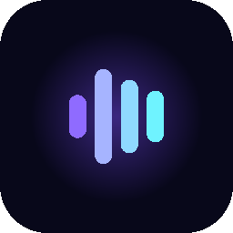
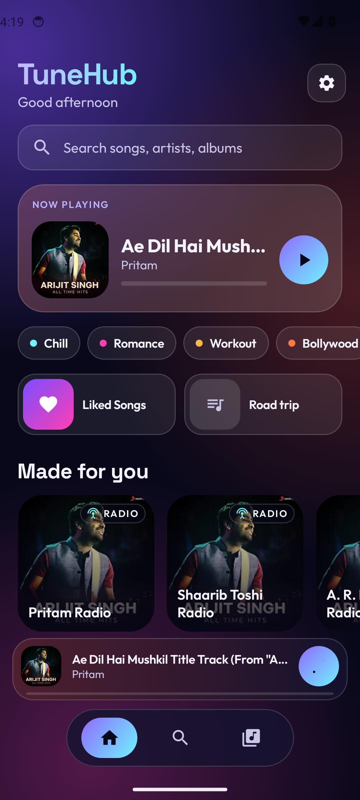
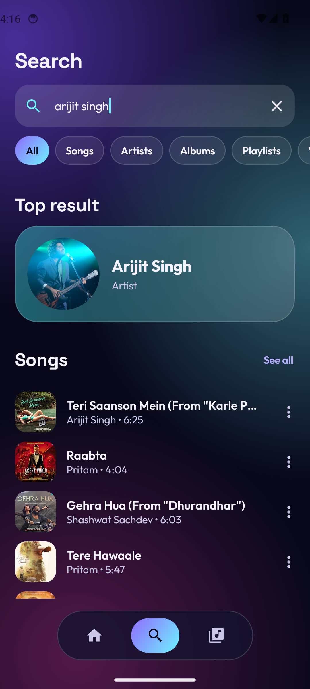
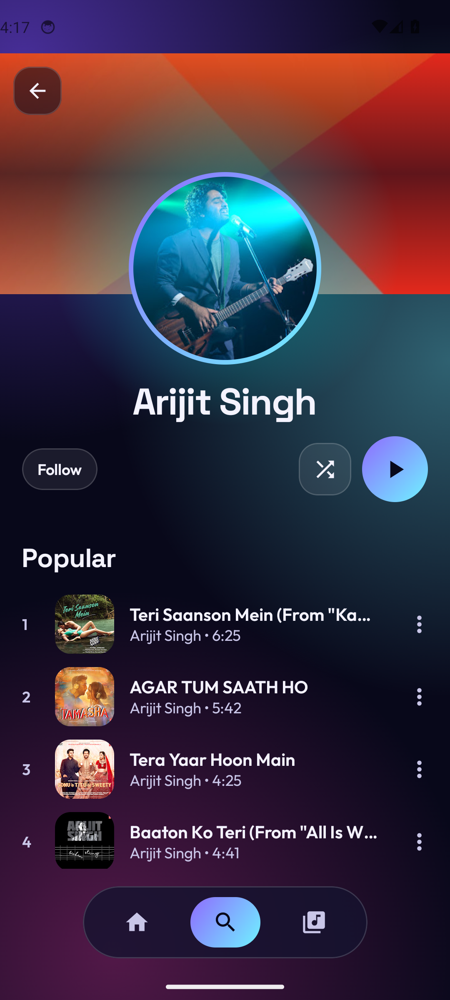
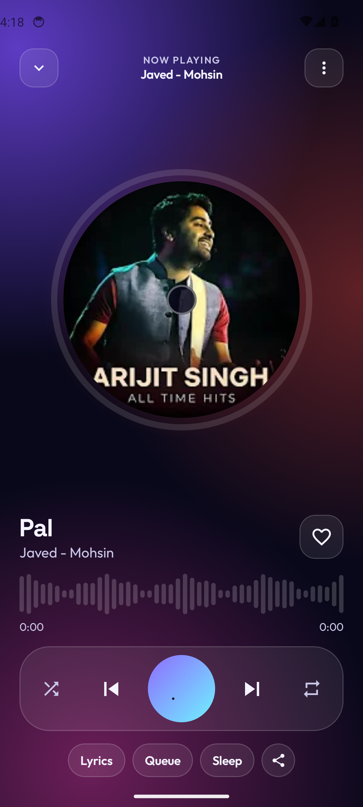

<div align="center">



# TuneHub

**Ad-free music for Android, from YouTube Music.**
Search anything, tap play, lock your phone. No ads, no account, no subscription.

[](https://github.com/Xenomorph27/tunehub/releases/latest)
[](https://github.com/Xenomorph27/tunehub/actions/workflows/build.yml)
[](https://github.com/Xenomorph27/tunehub/releases)

[](LICENSE)

&nbsp;
&nbsp;
&nbsp;


</div>

## Install

1. On your Android phone, open **[Releases → latest](https://github.com/Xenomorph27/tunehub/releases/latest)**.
2. Under **Assets**, tap **`tunehub.apk`** to download it.
3. Open the file. If Android asks, allow installing apps from your browser, then tap **Install**.
   Play Protect may warn because the app isn't from the Play Store: tap **More details → Install anyway**.

New versions install right over the old one and keep your library.

## What it does

- **Fast start**: one request to YouTube before audio begins, and songs start loading the
  moment your finger touches them.
- **Hi-Res toggle** right on the Now Playing screen, and **UltraTune**: one tap for deep bass,
  clear vocals, crisp highs, a wide 3D stage and extra loudness.
- **Built-in equalizer** with presets, per-band sliders, bass boost, 3D sound and loudness.

- **Search with filters**: All, Songs, Artists, Albums, Playlists, Videos. "All" gives a top
  result plus a few of each, with suggestions as you type, recent searches and genre tiles.
- **Artist pages** with popular songs, discography and music videos. Follow your favourites.
- **Albums and playlists**: save them, play, shuffle or download the whole thing.
- **Your library**: Liked Songs, Downloads, your own playlists, saved albums and followed
  artists, with filters and sorting. Everything stays on your phone.
- **Now Playing**: round cover inside a live progress ring, waveform seek bar, swipe the
  cover to skip, time-synced lyrics, sleep timer, queue editing and a stream-quality badge.
- **Background playback** with lock-screen, notification and headphone controls.
- **Radio and autoplay**: start a radio from any song; when your queue ends it keeps going
  with related music. Home builds radio mixes from the artists you play.
- **Offline downloads** and a 512 MB streaming cache.
- **Share to TuneHub**: share any YouTube or YouTube Music link to the app to play it.

## How it works

TuneHub never loads YouTube's player, which is where the ads live. It asks YouTube Music for
search results and the song's audio stream directly, using
[NewPipeExtractor](https://github.com/TeamNewPipe/NewPipeExtractor), and plays that audio
in ExoPlayer inside a background media service.

```
TuneHub UI (Jetpack Compose) ──► MediaController ──► PlaybackService (ExoPlayer + MediaSession)
        │                                                   │
        └── search, artists, albums ──► NewPipeExtractor ◄──┘ audio stream lookup at play time
```

Audio is the best stream YouTube serves without Premium, usually Opus at about 160 kbps.
TuneHub skips YouTube's dynamic-range-compressed copies of the same audio. Lyrics come from
[LRCLIB](https://lrclib.net).

## Known limits

- **YouTube changes things.** Every few weeks something on YouTube's side shifts and playback
  can break until NewPipeExtractor ships a fix. Updating the extractor version in
  `app/build.gradle.kts` and pushing is usually all it takes.
- **No account features.** There's no sign-in, so no YouTube Music history or Premium
  256 kbps audio.
- **Not on the Play Store**, and it won't be.

## Build it yourself

Open the project in Android Studio, or with the Android SDK and Gradle 8.11:

```bash
gradle assembleRelease
```

- Every push to `main` builds a signed APK in GitHub Actions and publishes it as the
  **latest** release.
- `gradle testReleaseUnitTest` runs live smoke tests against YouTube Music and LRCLIB.
- The **UI check** workflow (Actions tab → Run workflow) boots an emulator, clicks through
  the main screens and uploads screenshots.

## License and disclaimer

TuneHub is free software under the [GNU GPL v3](LICENSE), the same license as
NewPipeExtractor, which it builds on.

It's a personal project, not affiliated with YouTube or Google. Using it may go against
YouTube's Terms of Service, so use it at your own discretion.
